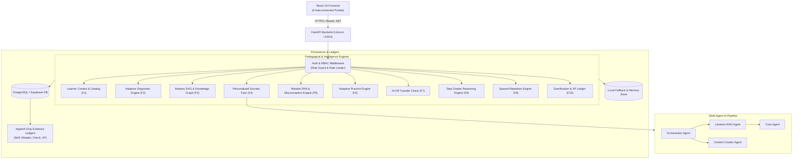
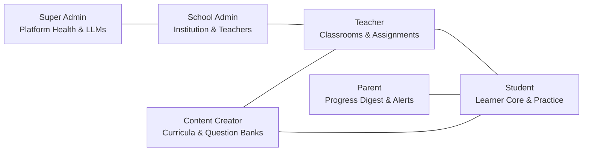
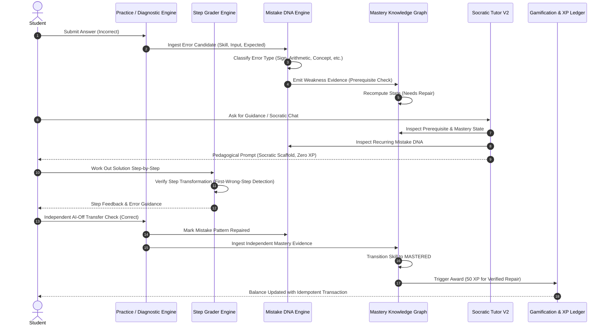

# LearnByGenie — System Architecture Specification

**Version:** 2.0.0  
**Status:** Canonical Architecture Blueprint  
**Audience:** Principal Architects, Full-Stack Engineers, AI Engineers, Security Engineers  

---

## 1. System Overview

LearnByGenie is an enterprise AI-native personalized learning platform built on a decoupled, asynchronous, and pedagogically rigorous architecture:

- **Frontend:** Single Page Application (SPA) built with React 19, TypeScript, Vite, TailwindCSS, and Framer Motion.
- **Backend:** High-throughput asynchronous API built with FastAPI, Python 3.11/3.13, and Pydantic v2.
- **Persistence & Vector Storage:** PostgreSQL (Supabase / local hybrid), pgvector for semantic retrieval, and append-only evidence ledgers.
- **AI / LLM Orchestration:** Multi-agent pipeline (Orchestrator, Librarian, Tutor, Content Creator) with multi-model fallback (Google Gemini 3.6/2.5 Flash, Groq gpt-oss-120b / Qwen, OpenRouter gpt-4o), circuit breakers, and rate limiters.

---

## 2. Six Interconnected Portals Architecture

The system supports six distinct stakeholder personas, each with dedicated dashboards, scoped workflows, and role-based permissions:

### 1. Student Portal (`/dashboard`, `/practice`, `/diagnostic`, `/mastery`, `/mistakes`, `/step-check`, `/transfer-check`, `/chat`, `/notes`, `/teach`, `/library`)
- **Primary Persona:** K-12 and Undergraduate Students (Grades 3–12 + UG).
- **Core Jobs:**
  - Complete initial onboarding and select academic curriculum (CBSE, ICSE, JEE, NEET, etc.).
  - Take diagnostic assessments to identify baseline strengths and prerequisite gaps.
  - Practice adaptive questions tailored to active misconceptions.
  - Verify reasoning step-by-step via Step Grader.
  - Demonstrate independent transfer of skills without AI scaffolding.
  - Review learning roadmaps, AI notes, and socratic chat sessions.
  - Track mastery progress, review spaced repetition flashcards, and earn verifiable XP.

### 2. Parent Portal (`/parent/dashboard`, `/parent/children`, `/parent/reports`, `/parent/settings`)
- **Primary Persona:** Parents and Legal Guardians.
- **Core Jobs:**
  - Link student accounts via secure parental invitation codes or parent-initiated email invites.
  - Monitor children's learning time, completed sessions, and study streaks.
  - View real-time mastery growth across subjects (Mathematics, Physics, Chemistry, Biology).
  - Inspect recurring Mistake DNA patterns and verified educational repairs.
  - Receive automated weekly learning digests and curriculum milestone notifications.

### 3. Teacher Portal (`/teacher/dashboard`, `/teacher/classes`, `/teacher/assignments`, `/teacher/analytics`, `/lesson-planner`, `/decks`, `/quizzes`, `/join`)
- **Primary Persona:** Classroom Teachers, Tutors, and Academic Mentors.
- **Core Jobs:**
  - Manage classrooms, batches, and student rosters.
  - Assign diagnostic tests, adaptive practice sessions, or specific skill targets.
  - Inspect aggregated classroom heatmaps: identify common class-wide misconceptions.
  - Generate standards-aligned lesson roadmaps (`/lesson-planner`) and interactive slides (`/decks`).
  - Host live synchronous classroom quizzes with anti-tamper client journals (`/join`, `/quiz/:id/live`).

### 4. School Administrator Portal (`/school-admin/dashboard`, `/school-admin/teachers`, `/school-admin/classes`, `/school-admin/curriculum`, `/school-admin/analytics`)
- **Primary Persona:** Principals, Deans, and Department Heads.
- **Core Jobs:**
  - Manage school-wide profiles, academic calendars, and department structures.
  - Provision and supervise teacher accounts.
  - View school-wide analytics: pass rates, mastery progression, and curricular coverage.
  - Manage institutional seat allocations and license compliance.

### 5. Content Creator Portal (`/creator/dashboard`, `/creator/curriculum`, `/creator/item-bank`, `/creator/review`, `/creator/templates`)
- **Primary Persona:** Curriculum Designers, Subject Matter Experts (SMEs), and Content Authors.
- **Core Jobs:**
  - Curate and expand canonical curriculum blueprints (Domains, Skills, Prerequisites).
  - Author and validate diagnostic and practice items with metadata (Difficulty, Error Distractors, Explanations).
  - Review and calibrate AI-generated content (notes, lesson plans, presentation slides).
  - Maintain the official Misconception Catalog.

### 6. Super Administrator Portal (`/admin/dashboard`, `/admin/users`, `/admin/providers`, `/admin/telemetry`, `/admin/vault`)
- **Primary Persona:** Platform Operations Engineers and System Administrators.
- **Core Jobs:**
  - Platform-wide tenant management and global user role assignments.
  - LLM Provider health monitoring (Gemini, Groq, OpenRouter latency, error rates, circuit breaker states).
  - Cost tracking, token expenditure telemetry, and rate-limit configuration.
  - Key vault management and canary credential rotation.

---

## 3. Core Pedagogical Engines & Closed Learning Loop

The heart of LearnByGenie is its **Closed Evidence Feedback Loop**. When a student makes an error or solves a problem, evidence cascades deterministically through the underlying intelligence engines without artificial score inflation:

---

## 4. Multi-Agent Pipeline Specifications

1. **Orchestrator Agent (`app/agents/orchestrator.py`):**
   - Classifies user intent (`doubt`, `quick_qa`, `concept_learning`, `practice_request`, `content_request`, `progress_check`, `clarify`, `general_chat`).
   - Extracts subject and topic ontology keys.
   - Selects teaching mode (`QUICK_ASK` vs `TUTOR`).
   - Routes to appropriate downstream agent.

2. **Librarian Agent (`app/agents/librarian.py`):**
   - Performs scoped RAG retrieval over student-uploaded course materials and notes.
   - Strict tenant isolation: enforces `user_id == current_user.id` on all vector lookups.
   - Falls back gracefully to web search (Tavily) if user context is insufficient.

3. **Socratic Tutor Agent (`app/services/tutor/service.py`):**
   - Implements 7-state pedagogical machine: `ORIENT` -> `EXPLAIN` -> `CHECK` -> `HINT` -> `RETEACH` -> `APPLY` -> `WRAP_UP`.
   - Adapts to learner grade level (Class 3 to UG) and language preference (English, Hindi, Hinglish).
   - Zero hallucinated scores; does not award unearned praise or fake progression.

4. **Content Creator Agent (`app/agents/content_creator.py`):**
   - Synthesizes pedagogical assets: Flashcard decks, PowerPoint decks (`.pptx`), and Video lesson scripts.
   - Layout compiler with strict typography, design tokens, and slide archetype consistency.

---

## 5. Security & Isolation Architecture

1. **Server-Side Role-Based Access Control (RBAC):**
   - All protected routes enforce `Depends(get_current_user)` and `Depends(require_role([...]))`.
   - Roles: `student`, `parent`, `teacher`, `school_admin`, `content_creator`, `super_admin`.
   - Tokens verified against Supabase JWT secret or local cryptographically secure offline fallback.

2. **Tenant & Data Isolation:**
   - Every database query strictly filters by `user_id` or tenant institution ID.
   - Parents can only query children linked via confirmed `parent_student_links` records.
   - Teachers can only query students enrolled in their assigned `classrooms`.
   - School administrators can only query members of their designated `school_id`.

3. **Fail-Closed Resilience:**
   - If an external cloud database or provider is unreachable, services fail safely without leaking data across tenants or granting unauthorized access.

