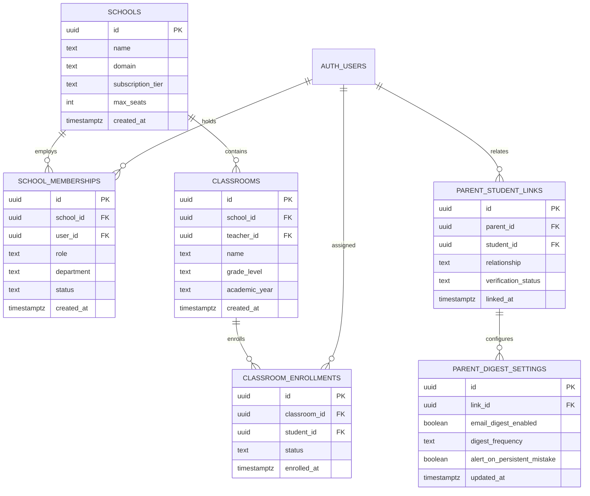
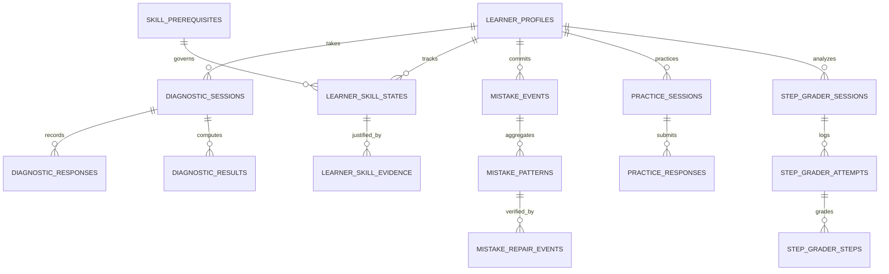
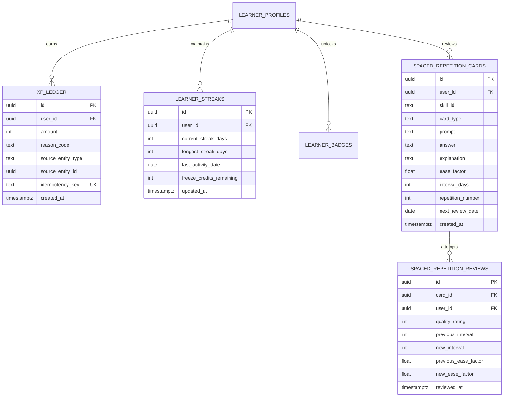

# LearnByGenie — Database Architecture & Schema Specification

**Version:** 2.0.0  
**Status:** Canonical Database Design Document  
**Target Engine:** PostgreSQL 15+ / Supabase  

---

## 1. Schema Overview & Evolution

The LearnByGenie database is organized into logical functional domains managed through numbered sequential migrations (`backend/migrations/`):

```
Migrations 001–020: Foundation & Classroom Tools
├── 001–003: Video lessons, pilot sessions, and topic decks
├── 004: Course graphs, roadmaps, and stage events
├── 005–008: Pricing, usage tracking, vector top chunks, PDF processing
├── 009: Quiz engine (quizzes, questions, attempts)
├── 010–012: TeachMe sessions and chat message history
├── 014–015: Real-time Live Quiz sessions, participants, responses, stats
├── 016–020: Generated notes, knowledge packs, canary vault
│
Migrations 021–029: Core Pedagogical & Reasoning Engines
├── 021: Academic catalog & canonical learner profiles
├── 022: Adaptive diagnostic engine (domains, skills, items, sessions, responses, results)
├── 023: Mastery knowledge graph & prerequisite DAG (prerequisites, skill states, evidence)
├── 024: Socratic tutor sessions & check response ledger
├── 025: Mistake DNA engine (mistake events, patterns, repair evidence)
├── 026: Adaptive practice engine (policy versions, practice items, sessions, responses)
├── 027: AI-off independent transfer check engine
├── 028–029: Step grader reasoning engine (policy versions, sessions, attempts, step checks)
│
Migrations 030–031: Institutional Portals, Gamification & Spaced Repetition (Target Design)
├── 030: User roles, schools, classrooms, enrollments, parent-student relationships
└── 031: Append-only XP ledger, learner streaks, badges, spaced repetition review schedule
```

---

## 2. Entity-Relationship Diagrams (ERD)

### 2.1 Institutional & Multi-Portal Hierarchy (Migration 030)



### 2.2 Pedagogical Evidence & Learning Cycle (Migrations 021–029)



### 2.3 Gamification & Spaced Repetition (Migration 031)



---

## 3. Migration 030 Specification: Roles & Institutional Portals

```sql
-- 030_user_roles_and_institutional_portals.sql

-- 1. Institutional Entities (Schools)
CREATE TABLE IF NOT EXISTS public.schools (
    id UUID PRIMARY KEY DEFAULT gen_random_uuid(),
    name TEXT NOT NULL,
    domain TEXT UNIQUE,
    subscription_tier TEXT NOT NULL DEFAULT 'free', -- 'free', 'standard', 'enterprise'
    max_seats INT NOT NULL DEFAULT 50,
    created_at TIMESTAMPTZ NOT NULL DEFAULT timezone('utc', now()),
    updated_at TIMESTAMPTZ NOT NULL DEFAULT timezone('utc', now())
);

-- 2. School Memberships (School Admins, Teachers, Staff)
CREATE TABLE IF NOT EXISTS public.school_memberships (
    id UUID PRIMARY KEY DEFAULT gen_random_uuid(),
    school_id UUID NOT NULL REFERENCES public.schools(id) ON DELETE CASCADE,
    user_id UUID NOT NULL,
    role TEXT NOT NULL CHECK (role IN ('school_admin', 'teacher', 'staff')),
    department TEXT DEFAULT 'General',
    status TEXT NOT NULL DEFAULT 'active' CHECK (status IN ('active', 'invited', 'suspended')),
    created_at TIMESTAMPTZ NOT NULL DEFAULT timezone('utc', now()),
    UNIQUE(school_id, user_id)
);

-- 3. Classrooms (Batches / Cohorts)
CREATE TABLE IF NOT EXISTS public.classrooms (
    id UUID PRIMARY KEY DEFAULT gen_random_uuid(),
    school_id UUID NOT NULL REFERENCES public.schools(id) ON DELETE CASCADE,
    teacher_id UUID NOT NULL,
    name TEXT NOT NULL,
    grade_level TEXT NOT NULL,
    academic_stream TEXT DEFAULT 'general',
    academic_year TEXT NOT NULL DEFAULT '2026-2027',
    created_at TIMESTAMPTZ NOT NULL DEFAULT timezone('utc', now())
);

-- 4. Classroom Enrollments (Students enrolled in a class)
CREATE TABLE IF NOT EXISTS public.classroom_enrollments (
    id UUID PRIMARY KEY DEFAULT gen_random_uuid(),
    classroom_id UUID NOT NULL REFERENCES public.classrooms(id) ON DELETE CASCADE,
    student_id UUID NOT NULL,
    status TEXT NOT NULL DEFAULT 'enrolled' CHECK (status IN ('enrolled', 'withdrawn', 'completed')),
    enrolled_at TIMESTAMPTZ NOT NULL DEFAULT timezone('utc', now()),
    UNIQUE(classroom_id, student_id)
);

-- 5. Parent-Student Links
CREATE TABLE IF NOT EXISTS public.parent_student_links (
    id UUID PRIMARY KEY DEFAULT gen_random_uuid(),
    parent_id UUID NOT NULL,
    student_id UUID NOT NULL,
    relationship TEXT NOT NULL DEFAULT 'guardian', -- 'mother', 'father', 'guardian'
    verification_status TEXT NOT NULL DEFAULT 'verified' CHECK (verification_status IN ('pending', 'verified', 'rejected')),
    invitation_code TEXT UNIQUE,
    linked_at TIMESTAMPTZ NOT NULL DEFAULT timezone('utc', now()),
    UNIQUE(parent_id, student_id)
);

-- 6. Parent Digest & Notification Settings
CREATE TABLE IF NOT EXISTS public.parent_digest_settings (
    id UUID PRIMARY KEY DEFAULT gen_random_uuid(),
    link_id UUID NOT NULL REFERENCES public.parent_student_links(id) ON DELETE CASCADE UNIQUE,
    email_digest_enabled BOOLEAN NOT NULL DEFAULT true,
    digest_frequency TEXT NOT NULL DEFAULT 'weekly' CHECK (digest_frequency IN ('daily', 'weekly', 'biweekly')),
    alert_on_persistent_mistake BOOLEAN NOT NULL DEFAULT true,
    alert_on_mastery_gain BOOLEAN NOT NULL DEFAULT true,
    updated_at TIMESTAMPTZ NOT NULL DEFAULT timezone('utc', now())
);
```

---

## 4. Migration 031 Specification: Gamification & Spaced Repetition

```sql
-- 031_gamification_and_spaced_repetition.sql

-- 1. Append-Only XP Ledger (Deterministic & Idempotent)
CREATE TABLE IF NOT EXISTS public.xp_ledger (
    id UUID PRIMARY KEY DEFAULT gen_random_uuid(),
    user_id UUID NOT NULL,
    amount INT NOT NULL CHECK (amount > 0),
    reason_code TEXT NOT NULL, -- 'DIAGNOSTIC_COMPLETION', 'MISTAKE_REPAIRED', 'STEP_CHECK_SUCCESS', 'PRACTICE_STREAK', 'DAILY_LOGIN'
    source_entity_type TEXT NOT NULL, -- 'diagnostic_session', 'mistake_repair', 'step_grader_attempt', 'practice_session', 'streak'
    source_entity_id UUID,
    idempotency_key TEXT NOT NULL UNIQUE,
    created_at TIMESTAMPTZ NOT NULL DEFAULT timezone('utc', now())
);

-- 2. Learner Streak Tracking
CREATE TABLE IF NOT EXISTS public.learner_streaks (
    id UUID PRIMARY KEY DEFAULT gen_random_uuid(),
    user_id UUID NOT NULL UNIQUE,
    current_streak_days INT NOT NULL DEFAULT 0,
    longest_streak_days INT NOT NULL DEFAULT 0,
    last_activity_date DATE NOT NULL DEFAULT CURRENT_DATE,
    freeze_credits_remaining INT NOT NULL DEFAULT 2,
    updated_at TIMESTAMPTZ NOT NULL DEFAULT timezone('utc', now())
);

-- 3. Learner Badges & Achievements
CREATE TABLE IF NOT EXISTS public.learner_badges (
    id UUID PRIMARY KEY DEFAULT gen_random_uuid(),
    user_id UUID NOT NULL,
    badge_key TEXT NOT NULL, -- 'DIAGNOSTIC_PIONEER', 'ERROR_TERMINATOR', 'FIRST_STEP_MASTER', 'PERSISTENCE_CHAMPION', 'TRANSFER_HERO'
    tier TEXT NOT NULL DEFAULT 'bronze' CHECK (tier IN ('bronze', 'silver', 'gold', 'platinum')),
    awarded_at TIMESTAMPTZ NOT NULL DEFAULT timezone('utc', now()),
    UNIQUE(user_id, badge_key)
);

-- 4. Spaced Repetition Flashcards (SuperMemo SM-2 Engine)
CREATE TABLE IF NOT EXISTS public.spaced_repetition_cards (
    id UUID PRIMARY KEY DEFAULT gen_random_uuid(),
    user_id UUID NOT NULL,
    skill_id TEXT NOT NULL,
    card_type TEXT NOT NULL DEFAULT 'concept_check', -- 'concept_check', 'formula_recall', 'mistake_avoidance'
    prompt TEXT NOT NULL,
    answer TEXT NOT NULL,
    explanation TEXT NOT NULL DEFAULT '',
    ease_factor FLOAT NOT NULL DEFAULT 2.50 CHECK (ease_factor >= 1.30),
    interval_days INT NOT NULL DEFAULT 1,
    repetition_number INT NOT NULL DEFAULT 0,
    next_review_date DATE NOT NULL DEFAULT CURRENT_DATE,
    created_at TIMESTAMPTZ NOT NULL DEFAULT timezone('utc', now()),
    updated_at TIMESTAMPTZ NOT NULL DEFAULT timezone('utc', now())
);

-- 5. Spaced Repetition Review Journal
CREATE TABLE IF NOT EXISTS public.spaced_repetition_reviews (
    id UUID PRIMARY KEY DEFAULT gen_random_uuid(),
    card_id UUID NOT NULL REFERENCES public.spaced_repetition_cards(id) ON DELETE CASCADE,
    user_id UUID NOT NULL,
    quality_rating INT NOT NULL CHECK (quality_rating BETWEEN 0 AND 5), -- SM-2 Quality: 0=Blackout, 3=Pass with difficulty, 5=Perfect
    previous_interval INT NOT NULL,
    new_interval INT NOT NULL,
    previous_ease_factor FLOAT NOT NULL,
    new_ease_factor FLOAT NOT NULL,
    reviewed_at TIMESTAMPTZ NOT NULL DEFAULT timezone('utc', now())
);
```

---

## 5. Security & Row-Level Security (RLS) Policies

All tables strictly enforce row-level security:

1. **Student Scoping:** `auth.uid() == user_id` for all personal records (`learner_profiles`, `diagnostic_sessions`, `practice_sessions`, `xp_ledger`, `spaced_repetition_cards`).
2. **Parent Scoping:** A parent can `SELECT` student records only if an active record exists in `parent_student_links` with `parent_id == auth.uid()` and `verification_status == 'verified'`.
3. **Teacher Scoping:** A teacher can `SELECT` student records only if the student is enrolled in a classroom where `teacher_id == auth.uid()`.
4. **School Admin Scoping:** A school admin can access records belonging to their assigned `school_id`.
5. **Super Admin Access:** Platform operators bypass tenant restrictions through privileged server-side roles.

