# LearnByGenie — Implementation Roadmap & Execution Status

**Version:** 2.1.0  
**Methodology:** Vertical Feature Slices, Test-Driven Verification, Zero Fabricated Claims  
**Status:** Canonical Implementation Plan & Execution Baseline  

---

## 1. Roadmap Overview & Phasing Status

```mermaid
flowchart TD
    P1["Phase 1: Critical Security & Persistence [COMPLETED]<br>• Production mock-token quarantine<br>• Removal of unverified JWT decode bypass<br>• Multi-tenant RBAC guards (6 roles)<br>• Verifiable parent-child invite handshake"] --> P2
    
    P2["Phase 2: Core Learning Loop Integration [COMPLETED]<br>• Canonical ErrorToken E01–E20 taxonomy<br>• 5-Tier Mastery verification (Tier 0 to Tier 5)<br>• SuperMemo SM-2 interval expansion engine<br>• Daily Roadmap (30% Repair · 50% Core · 20% Transfer)"] --> P3
    
    P3["Phase 3: Student Experience & Gamification [COMPLETED]<br>• Two-ledger architecture (Effort XP vs Mastery)<br>• Blueprint XP values (+50, +30, +40, +60, +45, +25)<br>• 10 XP/day anti-grinding cap on repeated easy items<br>• Dashboard integration with Choice Cards"] --> P4
    
    P4["Phase 4: Six Interconnected Portals [COMPLETED]<br>• Portal 1: Student (Roadmap, Practice, Mastery)<br>• Portal 2: Parent (Dashboard, Linked Children, Alerts)<br>• Portal 3: Teacher (Classes, Rosters, Heatmaps)<br>• Portal 4: School Admin (Institution, Teachers, Seats)<br>• Portal 5: Content Creator (Question Authoring, QA)<br>• Portal 6: Super Admin (Health, Multi-LLM Telemetry)"] --> P5
    
    P5["Phase 5: Content, AI & Quality Certification [COMPLETED]<br>• SymPy mathematical validation integration<br>• 31 calibrated diagnostic items + 48 practice items<br>• React 19 / TypeScript / Vite production build (0 errors)<br>• Pytest suites passed"] --> P6

    P6["Phase 6: Production Operations & Go-To-Market [ACTIVE NEXT MILESTONE]<br>• Cloud Supabase dedicated instance migration<br>• Cashfree / Razorpay production webhook activation<br>• DPDP 2023 legal counsel audit & compliance sign-off<br>• Scale vetted item bank to 1,000 Class 9–10 items"]
```

---

## 2. Completed Phase Deliverables & Forensic Evidence

### Phase 1 — Critical Security and Persistence (COMPLETED)
- **Remediated SEC-01:** Quarantined `MOCK_DEV_USERS` to non-production environments (`development`, `test`, `local`). Fail closed with 401 in production.
- **Remediated SEC-02:** Deleted `jwt.decode(..., verify_signature=False)`. Enforced cryptographic HS256 signature and expiration verification.
- **Remediated SEC-03:** Replaced hardcoded default student ID with verifiable invitation code handshake (`/api/portals/student/generate-parent-code` and `/api/portals/parent/link-child`).
- **Enforced RBAC Guards:** Server-side role validation (`require_student`, `require_parent`, `require_teacher`, `require_school_admin`, `require_content_creator`, `require_admin`).
- **Evidence:** `test_institutional_portals_and_gamification.py` passes all 15 tests.

### Phase 2 — Core Learning Loop Integration (COMPLETED)
- **ErrorToken Taxonomy (E01–E20):** Integrated 20 canonical error tokens into `MistakeClassifier` and schemas.
- **Mastery State Engine:** 5-tier state progression (Tier 0 to Tier 5) with independent transfer and delayed retention requirements.
- **Spaced Repetition (SM-2):** SuperMemo SM-2 interval expansion ($EF' = \max(1.30, EF + \dots)$) with review queues.
- **Daily Personalized Roadmap:** Implemented Stage 8 engine adhering to 30% Spaced Repair / 50% Core Progression / 20% Interleaved Transfer ratio.
- **Evidence:** `test_mistake_dna_engine.py` (23/23 passed) and `test_student_daily_roadmap_30_50_20` (passed).

### Phase 3 — Student Experience & Gamification (COMPLETED)
- **Two Separate Ledgers:** Ledger A (Engagement/Effort XP) is completely decoupled from Ledger B (Mastery Evidence).
- **Blueprint XP Alignment:** Baseline diagnostic (+50 XP), Active error resolution (+30 XP), Tier 3 independent proficiency (+40 XP), Tier 4 fresh transfer (+60 XP), Tier 5 delayed retention (+45 XP), Teach-back rubric pass (+25 XP).
- **Anti-Grinding Cap:** Repeated easy items award 2 XP, strictly capped at 10 XP/day.
- **Evidence:** `test_blueprint_xp_rewards_and_daily_cap` passed.

### Phase 4 — Six Interconnected Stakeholder Portals (COMPLETED)
- **Student Portal:** `/dashboard`, `/practice`, `/diagnostic`, `/mastery-map`, `/mistakes`, `/step-check`, `/transfer-check`, `/chat`.
- **Parent Portal:** `/parent/dashboard`, `/parent/child/:id`.
- **Teacher Portal:** `/teacher/dashboard`, `/teacher/classroom/:id`, `/lesson-planner`, `/decks`, `/quiz/:id/live`.
- **School Admin Portal:** `/school-admin/dashboard`.
- **Content Creator Portal:** `/creator/dashboard`.
- **Super Admin Portal:** `/admin/dashboard`.
- **Evidence:** `test_parent_portal_dashboard_api`, `test_teacher_portal_dashboard_api`, `test_school_admin_portal_overview_api`, `test_creator_portal_dashboard_api`, `test_super_admin_portal_overview_api` all passed.

---

## 3. Next Milestone: Phase 6 Production Deployment & Operational Readiness

1. **Cloud PostgreSQL Migration Execution:**
   - Execute migrations 001–031 on a dedicated, production-tier Supabase PostgreSQL instance to eliminate DNS lookup timeouts on the free-tier instance.
2. **Payment Provider Webhook Verification:**
   - Wire Cashfree / Razorpay production webhooks with HMAC-SHA256 signature verification and server-side subscription entitlement grants.
3. **Question Bank Expansion:**
   - Execute the 3-sprint editorial review pipeline to expand active vetted Class 9–10 items from 79 to 1,000.
4. **DPDP Compliance Sign-off:**
   - Formal sign-off with accredited Indian legal counsel on privacy notices and parent consent records.
