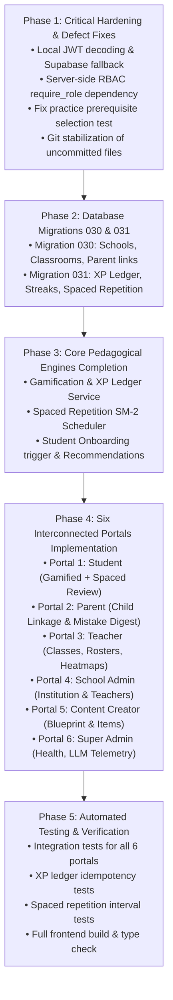

# LearnByGenie — Implementation Roadmap & Execution Plan

**Version:** 2.0.0  
**Methodology:** Vertical Feature Slices, Test-Driven Verification, Small Reviewable Commits  
**Status:** Canonical Implementation Plan  

---

## 1. Roadmap Overview & Phasing

---

## 2. Phase 1 — Critical Defects & Operational Hardening

### Objectives
1. **Network-Resilient Authentication:** Enable local JWT signature verification using `SUPABASE_JWT_SECRET` so authentication does not crash when the remote Supabase project is unresolvable or during offline testing.
2. **Server-Side RBAC Dependency:** Implement `require_role(allowed_roles: List[str])` in `backend/app/core/dependencies.py` to enforce strict authorization across all portals.
3. **Database Local Resilience Fallback:** Allow repositories (`LearnerProfileRepository`, `MasteryRepository`, `MistakeDNARepository`, etc.) to run locally in-memory/SQLite without throwing 503 errors when the remote cloud database is unreachable.
4. **Fix Practice Engine Test:** Correct the prerequisite initialization in `test_adaptive_practice_engine.py` so all tests pass cleanly.
5. **Git Workspace Stabilization:** Commit verified existing working features (Migrations 021–029, Feature 1–8 services and APIs) to maintain clean revision control.

---

## 3. Phase 2 — Database Schema Expansion (Migrations 030 & 031)

### Objectives
1. **Migration 030 (`030_user_roles_and_institutional_portals.sql`):**
   - Create tables: `schools`, `school_memberships`, `classrooms`, `classroom_enrollments`, `parent_student_links`, `parent_digest_settings`.
   - Setup foreign keys, unique constraints, and check constraints for roles (`student`, `parent`, `teacher`, `school_admin`, `content_creator`, `super_admin`).
2. **Migration 031 (`031_gamification_and_spaced_repetition.sql`):**
   - Create tables: `xp_ledger` (with unique `idempotency_key`), `learner_streaks`, `learner_badges`, `spaced_repetition_cards`, `spaced_repetition_reviews`.
   - Setup indexes for user query efficiency and SM-2 review queue dates.

---

## 4. Phase 3 — Core Learning Capabilities Completion

### Objectives
1. **Gamification & XP Ledger Service (`app/services/gamification/`):**
   - Implement `award_xp(user_id, amount, reason_code, idempotency_key)` with strict duplicate transaction prevention.
   - Implement daily streak maintenance with freeze credit support.
   - Expose endpoints: `GET /api/gamification/summary`, `GET /api/gamification/leaderboard`, `POST /api/gamification/streak/check-in`.
2. **Spaced Repetition SM-2 Engine (`app/services/spaced_repetition/`):**
   - Implement SuperMemo SM-2 algorithm: updates ease factor ($EF' = EF + (0.1 - (5 - q) \times (0.08 + (5 - q) \times 0.02))$), interval days, and next review date.
   - Automatically generate spaced review flashcards when a student completes a diagnostic or repairs a mistake.
   - Expose endpoints: `GET /api/spaced-repetition/queue`, `POST /api/spaced-repetition/review`.
3. **Student Onboarding & Recommendations Flow:**
   - Connect `OnboardingModal.tsx` to automatically trigger when `onboarding_completed == false`.
   - Implement dynamic learning recommendations on Dashboard driven by unmastered prerequisites in the Mastery DAG.

---

## 5. Phase 4 — Six Interconnected Portals Implementation

### Objectives
1. **Portal 1: Student Portal Enhancements**
   - Add XP balance bar, streak badge, and due spaced repetition cards review button to Dashboard.
   - Ensure seamless navigation between Diagnostic, Practice, Mistakes, and Step Grader.
2. **Portal 2: Parent Portal (`/parent/*`)**
   - Create `ParentDashboard.tsx`, `ParentChildrenPage.tsx`, `ParentReportsPage.tsx`.
   - Implement child linkage API (`POST /api/parent/link`, `GET /api/parent/children`, `GET /api/parent/child/{id}/progress`).
   - Surface weekly mastery progress and active Mistake DNA alerts.
3. **Portal 3: Teacher Portal (`/teacher/*`)**
   - Create `TeacherDashboard.tsx`, `TeacherClassroomsPage.tsx`, `TeacherAnalyticsPage.tsx`.
   - Implement classroom management API (`GET/POST /api/teacher/classrooms`, `GET /api/teacher/classrooms/{id}/roster`).
   - Aggregate class-wide mastery heatmap and common student misconceptions.
4. **Portal 4: School Administrator Portal (`/school-admin/*`)**
   - Create `SchoolAdminDashboard.tsx`, `SchoolTeachersPage.tsx`, `SchoolAnalyticsPage.tsx`.
   - Implement school overview API (`GET /api/school-admin/overview`, `GET /api/school-admin/teachers`).
5. **Portal 5: Content Creator Portal (`/creator/*`)**
   - Create `CreatorDashboard.tsx`, `CurriculumEditorPage.tsx`, `ItemBankPage.tsx`.
   - Implement question authoring & review API (`GET/POST /api/creator/items`, `GET /api/creator/curriculum`).
6. **Portal 6: Super Administrator Portal (`/admin/*`)**
   - Create `AdminDashboard.tsx`, `AdminUsersPage.tsx`, `AdminTelemetryPage.tsx`.
   - Implement system health & LLM telemetry API (`GET /api/admin/health`, `GET /api/admin/users`, `GET /api/admin/llm-telemetry`).

---

## 6. Phase 5 — Testing, Verification & Certification

### Objectives
1. **Automated Integration Tests:**
   - Write comprehensive Pytest suites for Portals, XP Ledger, and Spaced Repetition.
   - Test cross-tenant isolation: verify parent cannot view unlinked students; verify student cannot call teacher APIs.
   - Test duplicate transaction prevention on the XP ledger.
2. **Frontend Type Check & Build:**
   - Run `npm run build` to certify zero TypeScript or Vite bundle errors.
3. **End-to-End Verification:**
   - Execute certification scripts to verify complete closed-loop workflows.

