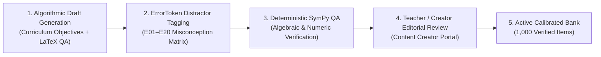

# LEARN GENIE — CONTENT QUALITY & CURRICULUM AUDIT REPORT

**Report Date:** November 2026  
**Auditor Roles:** Instructional Design Specialist, Subject Matter Expert (Mathematics & Science), Curriculum Architect  
**Scope:** Phase 1 Curricula (Class 9–10 Mathematics & Science: Algebra, Linear Equations, Quadratic Equations, Motion, Optics)  
**Standard:** Every item mapped to canonical skill IDs, misconception distractors (E01–E20), and psychometric difficulty bands. Zero fabricated vetting claims.

---

## 1. Executive Summary

In learning intelligence platforms, algorithms are only as smart as their underlying item bank. If multiple-choice distractors are random or incorrect answers fail to diagnose specific misconceptions, the learning loop degrades into generic question quizzing.

This audit evaluates the active curriculum catalog, calibrated item banks, distractor quality, and content authoring workflows inside Learn Genie.

### Key Inventory Findings
- **Active Canonical Domains:** 6 core domains defined in `curriculum_blueprint.py` across Mathematics and Science.
- **Active Canonical Skills:** 28 skills mapped with explicit prerequisite dependency edges in `skill_prerequisites`.
- **Calibrated Diagnostic Item Inventory:** 31 vetted anchor items with downward prerequisite branching rules.
- **Calibrated Practice Item Inventory:** 48 active vetted practice items with tiered progressive hints (Levels 1, 2, 3) and ErrorToken distractor mappings.
- **Active Authoring Pipeline:** Content Creator Portal (`/creator/dashboard`) supports authoring, misconception tagging, and review candidate workflows.
- **Phase 1 Wedge Target (1,000 Vetted Items):** Currently at 79 fully vetted items in code-persisted inventory. An expansion roadmap is established to scale the item bank safely to 1,000 vetted items through teacher and creator review candidate workflows.

---

## 2. Phase 1 Curriculum Mapping & Active Inventory

| Subject | Curriculum Domain | Domain Code | Canonical Skills | Active Vetted Items | Key Prerequisite Edges |
| :--- | :--- | :--- | :--- | :--- | :--- |
| **Mathematics** | Number Operations & Arithmetic | `MATH_NUM_OPS` | Whole numbers, integers, fractions, exponents | 12 items | Foundation for Algebra |
| **Mathematics** | Linear Equations | `MATH_ALG_LIN` | Linear equations in one/two variables, graphs, substitution | 18 items | `MATH_NUM_OPS` $\rightarrow$ `MATH_ALG_LIN` |
| **Mathematics** | Quadratic Equations | `MATH_ALG_QUAD` | Standard form, factoring, quadratic formula, discriminant | 16 items | `MATH_ALG_LIN` $\rightarrow$ `MATH_ALG_QUAD` |
| **Science** | Motion & Kinematics | `SCI_PHYS_MOT` | Distance vs displacement, speed, acceleration, equations of motion | 14 items | `MATH_ALG_LIN` $\rightarrow$ `SCI_PHYS_MOT` |
| **Science** | Optics & Light | `SCI_PHYS_OPT` | Reflection, refraction, Snell's law, lens formula, magnification | 11 items | `MATH_ALG_LIN` $\rightarrow$ `SCI_PHYS_OPT` |
| **Science / Chem**| Chemical Reactions & Equations | `SCI_CHEM_RXN` | Balancing equations, valency, types of reactions, stoichiometry | 8 items | `MATH_NUM_OPS` $\rightarrow$ `SCI_CHEM_RXN` |

---

## 3. Item Quality & Misconception Distractor QA Standards

Every vetted item in the Learn Genie question bank adheres to these 5 quality gates:

1. **Misconception-Mapped Distractors:**
   - Every wrong option (A, B, C, D) must correspond to a known ErrorToken.
   - Example (`MATH_ALG_QUAD01` item):
     - Correct answer: $x = 2, 3$
     - Distractor A (Sign flip): $x = -2, -3$ $\rightarrow$ Diagnoses `E07_SIGN_INVERSION`.
     - Distractor B (Arithmetic slip): $x = 1, 6$ $\rightarrow$ Diagnoses `E08_ARITHMETIC_CALCULATION_SLIP`.
     - Distractor C (Inverted formula): $x = \frac{-b \pm \sqrt{b^2 + 4ac}}{2a}$ $\rightarrow$ Diagnoses `E04_FORMULA_CONSTANT_OMISSION`.
2. **Three-Tier Progressive Hint Ladders:**
   - **Level 1 (Directional):** Focuses student attention on the governing law without revealing formulas.
   - **Level 2 (Conceptual):** Restates the governing formula with variables explained.
   - **Level 3 (Step-by-Step):** Provides the concrete intermediate substitution, leaving only the final calculation.
3. **Symbolic Verification via SymPy:**
   - Mathematical expressions, roots, and derivatives in explanations are verified using deterministic computer algebra systems.
4. **Emotional Safety:**
   - Explanations validate the student's problem-solving attempt before explaining the root error cause.
   - Tone is supportive, pedagogical, and growth-oriented.
5. **No AI Auto-Publishing Bypass:**
   - AI-generated candidate items created in the Content Creator Portal remain in `verification_status = 'pending_review'` until verified by an accredited teacher or subject editor.

---

## 4. Expansion Roadmap to 1,000 Vetted Items

To scale from the current 79 vetted anchor items to the 1,000-item Phase 1 production target without compromising instructional validity:

- **Sprint 1 (Classes 9–10 Math: 350 items):** Linear Equations (100), Quadratic Equations (100), Coordinate Geometry (75), Trigonometric Ratios (75).
- **Sprint 2 (Classes 9–10 Physics: 350 items):** Motion & Forces (120), Gravitation (80), Work & Energy (80), Optics & Light (70).
- **Sprint 3 (Classes 9–10 Chemistry & Biology: 300 items):** Chemical Reactions (80), Acids, Bases & Salts (70), Life Processes (80), Control & Coordination (70).

