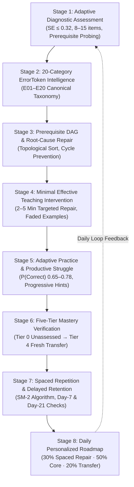

# LEARN GENIE — EIGHT-STAGE ERROR-TO-MASTERY LEARNING INTELLIGENCE SPECIFICATION

**Version:** 2.0.0  
**Status:** Canonical Pedagogical & Engineering Specification  
**Product:** Learn Genie (LearnByGenie)  
**Target Learner Population:** Indian Students in Classes 6–12, JEE Main, JEE Advanced, NEET-UG aspirants, and foundational STEM learners.

---

## 1. Engine Philosophy & Pedagogical Foundations

Learn Genie is built on the empirical foundation of Learning Sciences:
1. **Mastery Learning (Bloom, 1968):** Concepts must not be declared "mastered" until verified through independent, un-scaffolded performance.
2. **Retrieval Practice & Spacing (Roediger & Karpicke, 2006; Ebbinghaus, 1885):** Real learning requires effortful recall over spaced intervals (SM-2: 1d, 6d, $I \times EF'$), not passive video viewing.
3. **Productive Struggle & Zone of Proximal Development (Vygotsky, 1978):** Question difficulty is calibrated dynamically to maintain $P(\text{Correct}) \in [0.65, 0.78]$.
4. **Prerequisite Dependency Graphs:** Foundation gaps block advanced comprehension. Diagnosing and repairing the earliest unmastered prerequisite resolves downstream failure cascades.
5. **Emotionally Safe Learning:** Errors are framed as specific, fixable cognitive events (ErrorTokens), never personal deficiencies or IQ labels. Flashing punitive alarmist red is forbidden.

---

## 2. Stage 1 — Adaptive Diagnostic Assessment

### 2.1 Inputs & Configuration
The student initiates diagnosis by selecting:
- **Grade/Class:** Class 6 through Class 12, or Undergraduate STEM.
- **Board/Curriculum:** CBSE, ICSE, or State Boards.
- **Subject:** Mathematics, Physics, Chemistry, Biology, Computer Science.
- **Exam Track:** School/Board, JEE Main, JEE Advanced, NEET-UG.
- **Explanation Language:** English, Hindi, or Hinglish.

### 2.2 Psychometric Item Selection & Calibration
- Starts with representative anchor items at intermediate difficulty ($\theta = 0.0$, difficulty band `STANDARD`).
- **Response Evidence Rule:** Correct responses increase estimated proficiency $\hat{\theta}$ and branch upward to `CHALLENGE` items. Incorrect responses immediately probe foundational prerequisites.
- **Stopping Invariant:** Terminates when standard error reaches target $SE(\hat{\theta}) \le 0.32$ or maximum question budget (8–15 items) is reached.
- Calibrated item banks are stored server-side in `diagnostic_items`. Uncalibrated items use deterministic heuristic difficulty tiers until empirical response data exists. Global IQ labels are strictly prohibited.

---

## 3. Stage 2 — Twenty-Category ErrorToken Intelligence (E01–E20)

Errors are classified by the authoritative deterministic `MistakeClassifier` into the canonical **E01–E20** taxonomy:

| Token ID | Canonical Identifier | Description & Mechanism | Deterministic Heuristic / Rule |
| :--- | :--- | :--- | :--- |
| **E01** | `E01_CONCEPTUAL_MISUNDERSTANDING` | Misunderstanding of underlying physical or mathematical principles | Rubric match on conceptual mechanism, valency, or core law |
| **E02** | `E02_MISSING_PREREQUISITE` | Failure caused by missing foundational knowledge from prior grades | Prerequisite skill failure in DAG correlation |
| **E03** | `E03_INCORRECT_FORMULA_SELECTION` | Selection of wrong governing formula, theorem, or equation | Explicit formula mismatch in student work |
| **E04** | `E04_FORMULA_CONSTANT_OMISSION` | Omission of standard constants (e.g. 1/2 in kinetic energy, $\pi$, $g$) | Coefficient or factor missing in algebraic expression |
| **E05** | `E05_ALGEBRAIC_SETUP_ERROR` | Inaccurate translation from word problem to mathematical equations | Variable mapping or initial setup flaw |
| **E06** | `E06_ALGEBRAIC_TRANSPOSITION` | Variable isolation, cross-multiplication, or rearrangement slip | Transposition error detected across equal sign |
| **E07** | `E07_SIGN_INVERSION` | Negative sign flip, coordinate inversion, or direction error | Pure numerical sign flip ($s = -e$) or factor sign flip |
| **E08** | `E08_ARITHMETIC_CALCULATION_SLIP` | Minor arithmetic computation slip with correct underlying steps | Small numeric deviation ($\le 2$ or $\le 25\%$ relative error) |
| **E09** | `E09_MISREAD_QUESTION_TARGET` | Answering wrong target variable (e.g., perimeter instead of area) | Inverted target variable detected in response |
| **E10** | `E10_INVERTED_CONDITION` | Neglecting strict inequality, boundary condition, or constraint | Boundary or constraint flip detected |
| **E11** | `E11_UNIT_OMISSION` | Omitting mandatory physical unit in numeric solution | Number present but expected physical unit absent |
| **E12** | `E12_UNIT_CONVERSION_ERROR` | Unit mismatch or dimensional scale factor error (e.g. km/h to m/s) | Unit mismatch detected against expected dimension |
| **E13** | `E13_FLAWED_REASONING_PREMISE` | Invalid deductive reasoning, false assumption, or causal fallacy | Logic flaw or false deductive premise identified |
| **E14** | `E14_INVALID_DERIVATION_STEP` | Mathematically illegal derivation step (e.g. dividing by zero) | Symbolic invalid step caught by Step Grader / SymPy |
| **E15** | `E15_DEFINITION_RECALL_GAP` | Scientific term, notation, or formal definition recall gap | Scientific terminology or nomenclature slip |
| **E16** | `E16_PROCEDURAL_STEP_ORDER` | Executing procedural steps out of order in multi-step algorithm | Out-of-order phase or execution sequence |
| **E17** | `E17_BOUNDARY_CONDITION_ERROR` | Index off-by-one, interval endpoint, or extreme value error | Boundary condition or array index error |
| **E18** | `E18_INCOMPLETE_RESPONSE_ABANDONED`| Attempt abandoned before reaching final solution | Empty, '?', 'idk', or skipped response |
| **E19** | `E19_UNSUPPORTED_GUESS` | Random or unsupported answer with zero derivation evidence | Rapid low-latency wrong choice with zero intermediate steps |
| **E20** | `E20_UNCLASSIFIED_AMBIGUOUS` | Ambiguous error mechanism; audited without fabrication | Unclassified fallback (no artificial certainty) |

### Pattern Progression Lifecycle
- **Occurrence 1:** `ISOLATED` (Single slip; never overgeneralized).
- **Occurrences 2–3:** `RECURRING` (Intervention recommended).
- **Occurrences $\ge 4$:** `PERSISTENT` (Blocking prerequisite repair triggered).
- **Independent Transfer Evidence:** `REPAIRED` (Verified through subsequent unassisted problem).
- **Post-Repair Recurrence:** `REASSESSMENT_NEEDED`.

---

## 4. Stage 3 — Prerequisite DAG & Root-Cause Repair

### 4.1 Graph Architecture & Topology
- Stored in `skill_prerequisites` table with `STRICT_PREREQUISITE` and `ADVISORY_PREREQUISITE` edges.
- Cycle Prevention: Topological sorter (`PrerequisiteDAGEngine`) validates graph acyclicity on every mutation using Kahn's algorithm.
- Identifies blocked concepts where at least one prerequisite is in `NEEDS_REPAIR`.
- Computes the **Earliest Unresolved Prerequisite**: Traces backward from the target skill to find the lowest unmastered foundation node.

---

## 5. Stage 4 — Minimal Effective Teaching Intervention

- Duration: **2 to 5 minutes**. Students are never dumped into generic 45-minute lectures.
- Structure:
  1. **Emotionally Safe Feedback:** Highlights what the student did correctly first.
  2. **Misconception Contrast Card:** Side-by-side contrast of the specific error token versus the correct reasoning.
  3. **Faded Worked Example:** Partially solved problem where the student completes the final critical step.
  4. **Metacognitive Teach-Back:** Short learner-generated explanation prompt (graded on rubric $\ge 2/3$).
  5. **Quick Checkpoint:** Single diagnostic item validating repair.

---

## 6. Stage 5 — Adaptive Practice and Productive Struggle

- **Target Success Rate:** $P(\text{Correct}) \in [0.65, 0.78]$.
- **Progressive Scaffolding (Hint Ladder):**
  - Level 1: Directional hint (prompts focus without giving method).
  - Level 2: Conceptual hint (recalls relevant law/theorem).
  - Level 3: Step-by-step scaffold (guides intermediate algebraic calculation).
- **Remedial Circuit Breaker:** After $\ge 3$ consecutive failures on a skill, the engine pauses question delivery and triggers a simpler visual explanation or prerequisite repair. Heavy hints count as assisted attempts and cannot grant Tier 3 proficiency.
- **Server-Authoritative:** All scoring, hints, and timers are calculated and validated on the backend.

---

## 7. Stage 6 — Five-Tier Mastery Verification

| Tier | Status Label | Verification Requirement |
| :--- | :--- | :--- |
| **Tier 0** | `NOT_ASSESSED` | Insufficient or zero learning evidence. |
| **Tier 1** | `NEEDS_REPAIR` | Diagnosed weakness or repeated error pattern in diagnostic/practice. |
| **Tier 2** | `DEVELOPING` | Guided repair or scaffolded proficiency with hint assistance. |
| **Tier 3** | `SECURE` | Independent proficiency: $\ge 2$ independent items with $\ge 80\%$ accuracy and 0 hints. |
| **Tier 4** | `TRANSFER_VERIFIED` | Fresh, unseen independent transfer problem without AI scaffolding (Transfer Engine). |
| **Tier 5** | `DELAYED_RETENTION` | Delayed retention verified via SM-2 review at Day-7 and Day-21 intervals. |

**Invariants:**
- Effort XP cannot promote mastery tiers.
- Repeating identical questions cannot count toward Tier 4 transfer.
- UI animations must never simulate a tier promotion not recorded in `learner_skill_states`.

---

## 8. Stage 7 — Spaced Repetition & Delayed Retention (SM-2)

### 8.1 SuperMemo SM-2 Interval Calculations
For each review attempt with quality rating $q \in \{1, 2, 3, 4, 5\}$:
1. **Ease Factor Update:**
   $$EF' = \max\left(1.30, EF + \left(0.1 - (5 - q) \times (0.08 + (5 - q) \times 0.02)\right)\right)$$
2. **Interval Days Progression:**
   $$\text{Interval} = \begin{cases} 1 & \text{if } q < 3 \text{ (failure, reset repetition to 0)} \\ 1 & \text{if } q \ge 3 \text{ and repetition } = 0 \\ 6 & \text{if } q \ge 3 \text{ and repetition } = 1 \\ \text{round}(\text{Interval} \times EF') & \text{if } q \ge 3 \text{ and repetition } \ge 2 \end{cases}$$
3. Spaced review cards are auto-generated whenever an error is repaired or a diagnostic is completed.
4. Retention checks require an actual active response with verified correctness.

---

## 9. Stage 8 — Daily Personalized Roadmap (30/50/20 Engine)

The daily study plan combines canonical learner state into a single actionable roadmap:
- **30% Spaced Error Repair:** Due SM-2 review cards and recurring Mistake DNA patterns ($\approx 12$ mins).
- **50% Core Progression:** Next unblocked ready concept from the Mastery DAG ($\approx 25$ mins).
- **20% Interleaved Transfer:** Unseen transfer checks on previously mastered concepts ($\approx 10$ mins).

The learner is presented with three structured next tasks with explicit durations, pedagogical reasons, and unlocking milestones. Recalculations occur immediately following meaningful evidence events.

